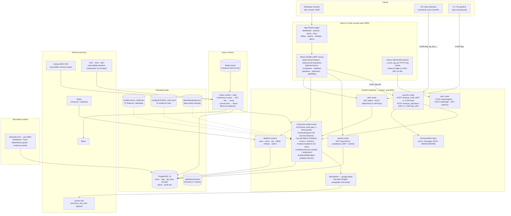

# Cyvex — Full-Stack Architecture

Mermaid source below renders on GitHub, VS Code (Markdown Preview
Mermaid extension), and `mermaid.live`. Component responsibilities,
request paths, and degradation behavior follow the diagram.



---

## Component responsibilities

| Component | Responsibility | Notes |
|---|---|---|
| **Next.js console** (`frontend/`) | Auth.js login (credentials + Google/GitHub OAuth), dashboard pages, BFF proxies that attach the JWT cookie | port 3000, `FASTAPI_URL` points at the API |
| **VS Code extension** (`vscode-extension/`) | Scans the active editor buffer via `POST /analyze_code` with `X-API-Key`; risk + verdict in a notification, full report in a static webview | zero runtime deps, talks **directly** to FastAPI (no BFF) |
| **FastAPI backend** (`src/api/`) | Auth (JWT sessions + bcrypt API keys), scanner routes, alerts, team/org admin, NCA report, Stripe billing | fail-closed: missing secrets refuse to start |
| **Engine stack** (`src/extractor/`, `src/model/`, `src/verification/`) | parse → features → risk → evidence → verdict → explain | runs **in-process** inside the API request; never raises to the client |
| **PostgreSQL** | Tenancy, credentials, alerts, audit | compose-internal, no host port |
| **Celery worker + Redis** (`src/worker/`) | Continuous repository watching on a beat schedule; persists alerts; Slack delivery with exponential backoff | broker never leaves the compose network |
| **Streamlit GUI** (`gui/`) | Research/ops view: live API probes, Pyvis dependency graph, evidence panels | port 8501 |
| **Gemini** | AI Copilot paragraph only | optional — unset key ⇒ fallback string, scan still succeeds |
| **model bundle / rules / graph** | Versioned artifacts loaded at startup | `run_pipeline.py --check` validates all three |

---

## Request paths

| Path | Auth | Flow |
|---|---|---|
| **Web scan (paste)** | JWT cookie | browser → `/api/scanner/analyze` (BFF) → `POST /analyze_code` → engine → report JSON → 3-column UI + AI paragraph |
| **Web scan (repository)** | JWT cookie | browser → `/api/scanner/repository` (multipart, 180s) → ZIP bounds → per-file engine → aggregated findings |
| **IDE scan** | `X-API-Key` | VS Code → `POST /analyze_code` directly → notification (`risk — verdict`) → webview report |
| **CI / alert check** | `X-API-Key` | pipeline → `POST /alert/check` → verdict + optional Slack webhook |
| **Compliance report** | JWT + admin | console → `/api/reports/nca-compliance` → `GET /reports/nca-compliance` → reportlab PDF |
| **Continuous watch** | internal | Celery beat → GitHub scraper → engine → `alerts` row → Slack |

## Auth planes

| Plane | Credential | Used by | Revocation |
|---|---|---|---|
| Human | `Authorization: Bearer <jwt>` (HS256, bounded TTL) | web console, report generation | secret rotation / TTL expiry |
| Machine | `X-API-Key: sk_live_...` (bcrypt-hashed, prefix-indexed) | VS Code extension, CI | `is_active=false`, per-key |
| Signing | `CYVEX_SIGNING_SECRET` (HMAC-SHA256) | outbound envelopes, fail-closed startup | env rotation |

`/analyze_code` accepts **either** plane (Phase 17): bearer wins when
present, key otherwise, neither ⇒ `401 missing_token` naming both.

## Degradation behavior (never fails a scan silently)

| Failure | Response |
|---|---|
| Model not loaded / predictor throws | `ml.model_available=false`, risk = `NEUTRAL_RISK` (0.5), error code named in JSON |
| Gemini error / no API key | `ai_explanation` = fallback string, scan proceeds |
| Explainability failure | `explain.available=false` with reason, scan proceeds |
| Parser refusal (size/depth/time) | `400 invalid_code` naming the guard |
| Unsupported language | `unsupported_language:<name>` refusal, no crash |
| DB outage on key auth | `503 database_unavailable` |
| JWT invalid + valid key attached | `401 invalid_token` — no silent fallback |

## Fixed pipeline order (never inferred from flags)

```
Data Collection → Feature Extraction → Model Training → Graph Building → Services
  (scrape, ingest)      (extract)           (train)           (graph)     (api, gui)
```

Ports: **3000** Next.js console · **8000** FastAPI · **8501** Streamlit ·
Postgres/Redis compose-internal only.
